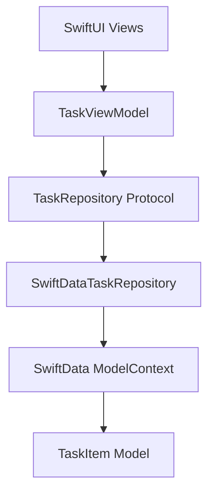

# OfflineTaskTracker

A native iOS task management app built with **SwiftUI, SwiftData, and MVVM**. OfflineTaskTracker helps users organize everyday work, manage priorities and deadlines, and track progress through a clean dashboard — with task data stored locally on the device.


<p align="center">
  
  
  
  
  
  
</p>

## Overview

OfflineTaskTracker is a fully local task management application designed around a simple workflow: create tasks, organize them, track deadlines, and review progress.

The app uses **SwiftData** for on-device persistence and an **MVVM architecture** to keep the UI, application logic, and data access separated. It does not require an account, backend service, or network connection for its core task-management features.

## Features

### Task management
- Create tasks with a title and optional description.
- Edit task details, priority, category, and due date.
- Delete tasks with a confirmation step.
- Mark tasks as completed and reopen them when needed.
- Keep creation and update timestamps for task tracking.

### Organization and discovery
- Assign each task a priority: High, Medium, or Low.
- Organize tasks by category.
- Search tasks by title or description.
- Filter tasks by status and category.
- Use quick date filters:
  - Due Today
  - Due This Week
  - Upcoming
  - Overdue
- Sort tasks by due date, priority, or recently created.
- Keep active tasks above completed tasks in the task list.

### Dashboard
- View total open and completed task counts.
- Track the overall completion percentage.
- See tasks due today.
- Review upcoming deadlines.
- View task counts by priority.
- See weekly task creation activity.

### Offline-first persistence
- Store task data locally with SwiftData.
- Retain tasks between app launches.
- Use a repository abstraction to separate data access from view-model logic.
- No backend or network connection is required for core functionality.

## Tech Stack

| Technology | Usage |
|---|---|
| Swift | Primary programming language |
| SwiftUI | Declarative user interface |
| SwiftData | Local data persistence |
| Observation | Observable view-model state |
| Swift Concurrency | Modern concurrency support |
| XCTest | Unit and UI automation testing |
| Xcode | Development and testing |

## Architecture

The project follows **Model–View–ViewModel (MVVM)** with a repository layer.



### Main layers

- **Models** — `TaskItem`, `TaskPriority`, and `TaskCategory` define the task data and its domain values.
- **Views** — SwiftUI screens display the dashboard, task list, task details, and task forms.
- **ViewModel** — `TaskViewModel` manages task operations, filtering, sorting, search, and dashboard calculations.
- **Repository** — `TaskRepository` defines the data-access contract, while `SwiftDataTaskRepository` implements it using SwiftData.

The app creates one shared `TaskViewModel` and supplies it to the Overview and Tasks tabs, keeping the displayed task state consistent across the app.

## Project Structure

```text
OfflineTaskTracker/
├── App/
│   └── OfflineTaskTrackerApp.swift
├── Models/
│   ├── TaskItem.swift
│   ├── TaskPriority.swift
│   └── TaskCategory.swift
├── Repositories/
│   └── TaskRepository.swift
├── ViewModels/
│   └── TaskViewModel.swift
├── Views/
│   ├── RootView.swift
│   ├── Dashboard/
│   │   └── DashboardView.swift
│   ├── Tasks/
│   │   ├── TaskListView.swift
│   │   ├── TaskFormView.swift
│   │   └── TaskDetailView.swift
│   └── Components/
│       └── TaskRowView.swift
└── OfflineTaskTrackerTests/
    ├── TaskItemRepositoryTests.swift
    └── TaskViewModelTests.swift
```

*The exact test-group and file names may differ depending on how the Xcode project is organized.*

## Screenshots

Add screenshots from the iPhone simulator to the `Screenshots/` directory and update the image paths below.

| Overview Dashboard | My Tasks |
|---|---|
| `Screenshots/dashboard.png` | `Screenshots/tasks.png` |

| Create Task | Task Details |
|---|---|
| `Screenshots/create-task.png` | `Screenshots/task-details.png` |

## Requirements

- macOS compatible with the installed Xcode version
- Xcode 26.2
- iOS 26.0 or later
- iPhone simulator or a compatible iPhone

## Getting Started

1. Clone the repository:

   ```bash
   git clone https://github.com/<your-username>/OfflineTaskTracker.git
   ```

2. Open the project in Xcode:

   ```bash
   cd OfflineTaskTracker
   open OfflineTaskTracker.xcodeproj
   ```

3. Select an iPhone simulator running iOS 26.0 or later.
4. Build and run the `OfflineTaskTracker` scheme.

No API keys, environment variables, or backend setup are required for the core app.

## Testing

The project includes unit tests and UI automation tests using XCTest.

| Test suite | Tests | Verified result |
|---|---:|---|
| Model and repository tests | 9 | Passed |
| ViewModel tests | 20 | Passed |
| UI automation tests | 5 | Passed |
| **Total** | **34** | **34 passed** |

Run the test suites from Xcode with **Product → Test** or press:

```text
⌘ + U
```

The UI automation suite covers the main user flows, including app launch, task creation, completion/reopening, editing, and deletion.

## Design and Engineering Highlights

- MVVM separation with a repository abstraction.
- A shared observable view model across the app's main tabs.
- Local-first data persistence with SwiftData.
- Search, filtering, and sorting handled in the view-model layer.
- Dashboard metrics derived from the current task collection.
- XCTest coverage for model, repository, view-model, and user-interface behavior.

## Roadmap

- [ ] Complete code-quality review for error handling and data consistency.
- [ ] Review accessibility and VoiceOver support.
- [ ] Review performance and edge cases.
- [ ] Add final app icon and App Store-style screenshots.
- [ ] Publish the v1.0 GitHub release.

## Author

**Your Name**

Rutik-Maraskolhe-iOS-Developer

---

<p align="center">
  Built with SwiftUI and a focus on clean iOS engineering.
</p>
